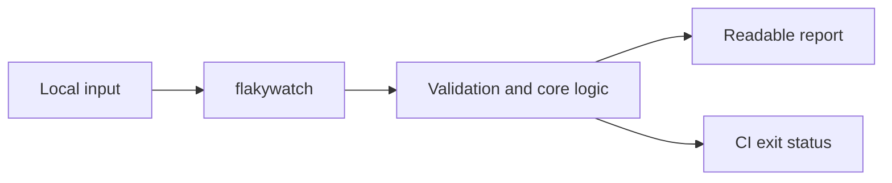

# flakywatch

<div align="center">
  
  <br/>
  
  
  
</div>

> Find intermittently failing tests by combining JUnit XML reports from repeated test runs.

## Why it exists

A focused, inspectable starter for a real developer workflow. It favors explicit behavior, local execution, and small pieces that are easy to understand and extend.

## Features

- Reads multiple JUnit XML report files
- Groups test cases by class and test name
- Flags tests that both pass and fail across runs
- Exports a concise JSON report for CI

## Architecture



## Requirements

- Python 3.10+ / standard library
- A terminal and a local checkout of this repository

## Quick start

```bash
python src/flakywatch.py reports/*.xml
```

## Example

```bash
python src/flakywatch.py reports/ --json
```

## Project status and limitations

This repository contains an initial working implementation, not a production-certified product. Review the source and test it against your own fixtures before adopting it in critical workflows.

A test is flagged only when the supplied reports contain both a pass and a failure for the same class/name pair.

## Roadmap

- [ ] Add duration variance analysis
- [ ] Support more report dialects
- [ ] Add baseline comparison between CI runs

## Contributing

Issues and pull requests are welcome. Include a small reproducible example for bug reports, keep changes focused, and add tests for new behavior. Do not submit secrets or private data.

## License

MIT. See [LICENSE](LICENSE). Third-party services or optional dependencies remain subject to their own terms.
